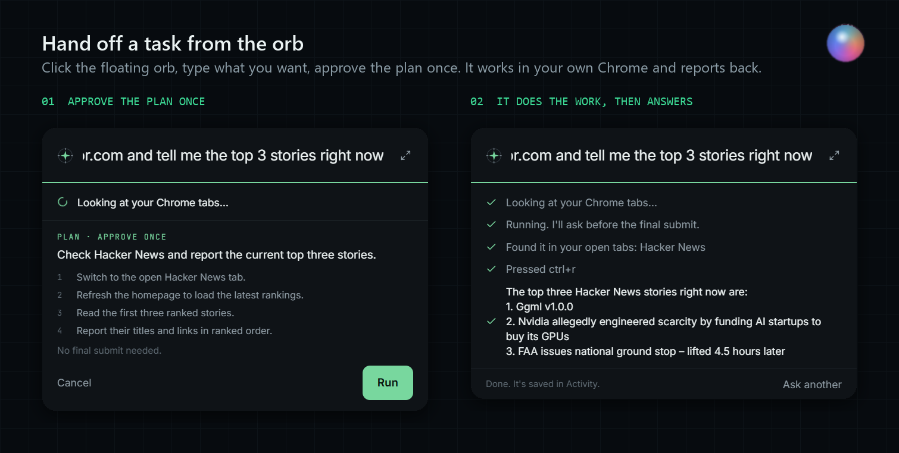
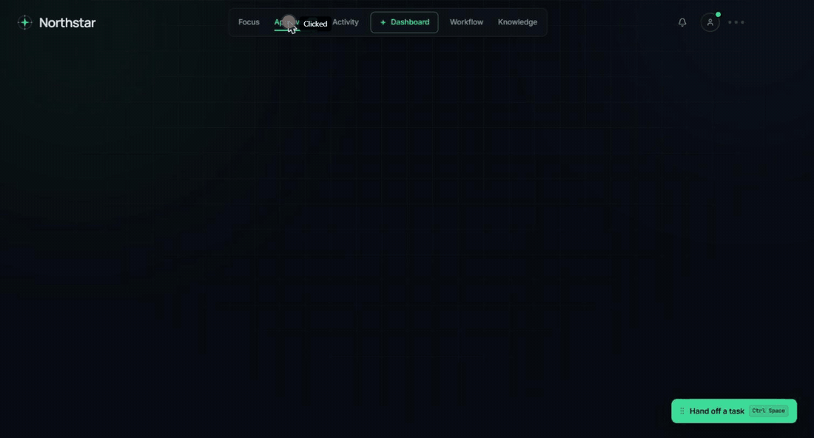
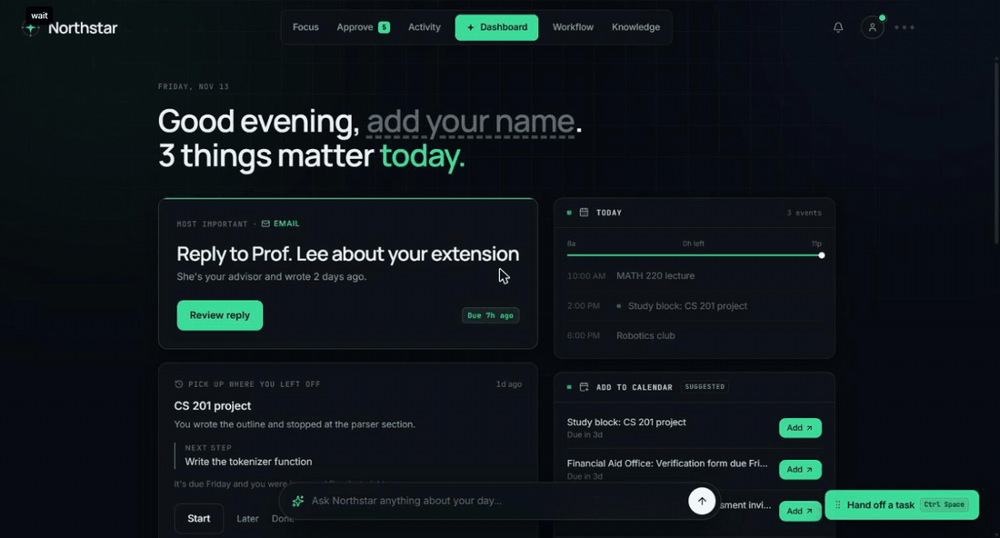
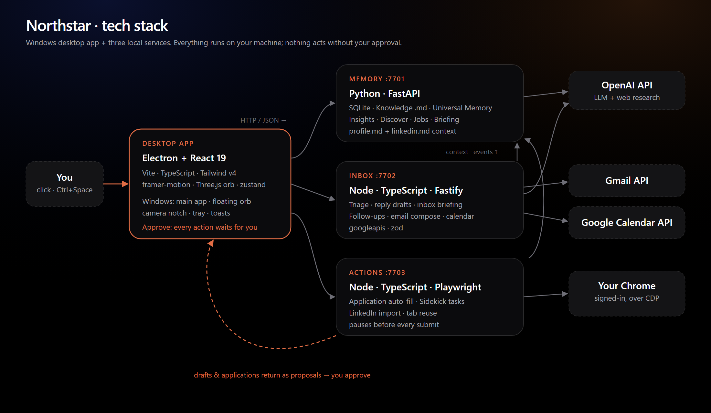

# Northstar

An AI assistant for students with ADHD that runs your week for you. It reads your Gmail and Google Calendar, works inside your own logged-in Chrome, finds and applies to internships, follows up on emails you forgot about, and comes to you before you go to it. Nothing gets sent, submitted or booked without your OK.

Sentient OS launched an AI desktop assistant for the Mac a few days before our hackathon. It isn't out on Windows yet, so I rebuilt the whole idea for Windows in about 5 hours at the SCET hackathon, then kept going and added the stuff I actually wanted: a browser extension so it works in my real Chrome, shared memory across my AI tools, a job hunter, and automatic follow-ups. I use it to run my own tasks now.

Not affiliated with Sentient OS. Built with Brian Huang and Cesar Cruz.

## Demo

The floating orb doing a real task in my own Chrome: one approval, then it does the work and answers.



Approving what Northstar prepared (a reply, a filled application, a study block, low-risk cleanup), then finding internships that match my profile and auto-filling three of them at once:



A quick tour: dashboard, approval queue, inbox, knowledge, focus mode and the calendar:



Both clips use the app's demo data so no real inbox shows up. Full video: [northstar-demo.mp4](docs/demo/northstar-demo.mp4).



## What it does

### It comes to you first
Northstar doesn't wait for you to open it. Every morning it builds a briefing from your inbox, calendar and memory, and picks one "Next Thing" for you to do, with a one-line reason ("due Sunday, no time blocked yet, and you focus best after 2pm"). Fewer decisions is the whole point when you have ADHD.

### Follows up on emails by itself
It watches your sent mail. If you emailed a recruiter or a professor and nobody answered in a few days, or someone replied and you never wrote back, it drafts the follow-up in your voice and pops a Windows notification. You approve it and it sends. Drafts are signed with your real name.

### Gmail triage and replies
Your inbox gets sorted into "needs you", "FYI" and "ignored for you". Deadlines and asks get pulled out of emails. Press Ctrl+Shift+D on an email and it drafts a reply. You can also just type "email Prof. Lee that I'll be late to lab" and it writes it.

### Calendar that fills itself in
Live Google Calendar in day, week and month view. Type "coffee with Maya friday at 3" and it becomes an event. When an email has a deadline with no time blocked for it, Northstar proposes focus blocks in the hours you actually work well, with reminders. It can also notice what you're working on (which app or site is in front, never the contents) and turn that into reminders and "pick up where you left off" prompts. That part is strictly opt-in.

### Works in your own logged-in Chrome
This is the part I'm proudest of. The Northstar Bridge extension connects your normal Chrome (already signed in to everything) to the app. You type a task into the floating orb, like "continue my YC application using my essay doc", and:

1. It looks at your open tabs and shows a short plan.
2. You approve once: **Run** (it asks before the final submit) or **Run & submit**.
3. It does the rest on its own. It reads pages, clicks, types and fills forms with real mouse and keyboard input, in your own Chrome, so it works on React forms and Google Docs too.
4. It only stops for the moments that matter: a final submit you didn't pre-approve, anything that costs money, a password (you sign in yourself), or a fact it doesn't know about you. You answer right in the popup and the same run keeps going.

It can read any tab you have open, including Google Docs, Sheets and Slides (it uses the file's own text export through your login, so no API setup), and switch between tabs to pull info from one into another.

### Your Google stuff
Gmail, Google Calendar, and Google Drive / Docs / Sheets / Slides, through your own Google account. Tokens stay on your machine.

### Shared memory with your other AI agents
Northstar keeps a memory of what it learns about you: plain Markdown files you can read and edit (who you are, your classes, goals, how you write, the people in your life) plus a searchable event log. It mirrors durable facts into [Universal Memory](https://pypi.org/project/universal-memory/) (`umem`), which Claude Code, Codex and other MCP agents can read too. So when Claude Code knows something about your project, Northstar knows it, and the other way around. Every decision it makes cites what it remembered.

### Internships and jobs
Import your LinkedIn profile (read in your own logged-in browser, no password handling) and Northstar searches for real, current internships and jobs, scores each one against your profile, and tells you which parts of your background match. Pick the best ones and it fills out the applications with your data, up to 5 at a time, and pauses before each submit for your OK.

### Discover
Research agents search the web for events, opportunities and side quests that fit you, and you can add them straight to your calendar.

### The notch, the orb, and touch to open
- A floating orb sits at the top of your screen. Click it for the Ask box, drag it anywhere.
- A Dynamic Island-style strip lives under your webcam. Hover it for a quick look at your day. On a MacBook it sits inside the real camera notch, and you can open it by touching the camera: cover the lens with a finger and it opens (Sentient has this on Mac, so I built it too).
- Ctrl+Space opens the command bar from anywhere.

### Focus mode
One task, full screen, with a big visual timer (time blindness is real) and an "I'm stuck" button that hands the task to the agent.

## How it works

Four local services plus the desktop app, all on `127.0.0.1`:

| Part | What it is | Port |
|---|---|---|
| `app/` | Electron + React 19 + Vite + Tailwind + Three.js. The orb, notch, Ask popup, dashboard, approvals | |
| `memory/` | Python FastAPI. SQLite + full-text search, Markdown knowledge folder, Universal Memory bridge, briefings, insights, jobs, Discover research | 7701 |
| `inbox/` | Node + Fastify. Gmail and Calendar sync, triage, drafts, follow-ups, Docs reading | 7702 |
| `actions/` | Node + Fastify + Playwright. The task agent, form filling, LinkedIn import, batch apply, the bridge to the extension | 7703 |
| `extension/` | Chrome MV3 extension. Runs tasks in your own signed-in Chrome over a local WebSocket | |

Every service writes what it sees to memory and reads memory before deciding anything. Anything irreversible (sending an email, submitting a form, creating an event) becomes a proposal you approve in one place. The LLM calls go to OpenAI (fast model for steps, smart model for planning).

Safety stuff I cared about:
- The services only accept calls from the Northstar app itself, and the bridge only accepts a Chrome extension, so a random website can't drive your browser.
- Payments and passwords always stop for you. The agent never types a password.
- Activity tracking is off by default and skips banking, health, sign-in pages and private windows.
- Your tokens, profile and memory never leave your computer (except the text sent to the model for each step).

## Run it

You need Node 20+, Python 3.12, [uv](https://docs.astral.sh/uv/) and Chrome.

```bash
cp .env.example .env    # add OPENAI_API_KEY, GOOGLE_CLIENT_ID, GOOGLE_CLIENT_SECRET, set MOCK=0
npm install
npm run dev:all         # starts memory, inbox, actions and the app
```

Then load the extension: open `chrome://extensions`, turn on Developer mode, click **Load unpacked**, and pick the `extension/` folder. Connect Google from the app.

With `MOCK=1` everything runs on demo data, no keys needed.

`cd app && npm run dist` builds a portable Windows .exe.

## Status

Hackathon project that I kept building. It runs my real inbox and calendar every day, but expect rough edges. Google Maps isn't wired in yet.
